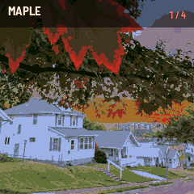
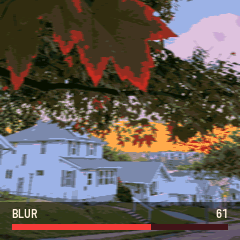

# ALBUM 01

Album is a series of firmwares for the M-VAVE FM-1, one per record. Each edition is a few deep sounds and the
photographs they came from, and each sound moves its photo as you play. Edition 01 follows one record: chords bent while they ring (glide guitar), heard mostly through a reverse reverb.

---

## Contents

1. Install
2. Playing
3. The four knobs
4. The patches
5. Two FM-1s as one
6. Saving
7. MIDI
8. The second core
9. Troubleshooting

---

## 1. Install

Try it first in the browser emulator: the same code, with sound. To install, open the install page in Chrome or Edge
with the FM-1 connected by USB. The installer saves a backup first and can put M-VAVE's firmware back.

## 2. Playing

The keys play. PRESET (the big knob) picks the patch, and with it the photo. The screen is the photo; a patch's name
shows at the top for a moment when you choose it, and a knob's value shows at the bottom while you turn it.

| Control | What it does |
| --- | --- |
| Keys | Play. Velocity counts. |
| PRESET | The next or previous patch (and its photo) |
| K1 to K4 | Glide, Swell, Tone, Blur |
| PLAY | Hold: the notes keep sounding after you let go (lit green). Again: let go. |
| OCT- / OCT+ | The octave, two down to two up |
| HOME | This patch's knobs back where it starts |
| SAVE | Keep everything: the patch, every patch's knobs, the octave (lit when something changed) |
| REC | Link to another FM-1 (section 5). Held a second: Bluetooth off or on |
| MASTER | Volume |

## 3. The four knobs

Every patch has the same four knobs. Each moves the sound and the photo together.

| Knob | The sound | The photo |
| --- | --- | --- |
| K1 Glide | How far the pitch wanders: the whole chord bent down and let back up, as a guitar's tremolo arm does, and each string drifting on its own | The rows waver sideways while a note sounds |
| K2 Swell | The reverse reverb's length: a quick lift to a slow rise over a second and a half | The red light swells |
| K3 Tone | Dark to bright, the reverb too | Darker to brighter |
| K4 Blur | How much of the sound is the reverb, and how smeared: clear to all wash | A sideways smear |

The warm light in each photo (the sun, a lamp) flickers with the sound's level.

## 4. The patches

Each patch has its own photo, and its sound comes from that photo.

| # | Patch | From the photo | Sound |
| --- | --- | --- | --- |
| 1 | MAPLE | The sun through a red maple leaf | A soft reed organ that sways slowly, warm on tape |
| 2 | DAHLIA | Pink dahlias in full sun | Bright fuzz chords bent hard, the wash behind them |
| 3 | RED HALL | One light in a red room at night | A low chord chopped by a fast tremolo, each side at its own speed |
| 4 | CLEMATIS | A bush of small white flowers | A breathy pad, half tone and half air; each note a cloud |

## 5. Two FM-1s as one

Two FM-1s running Album link over Bluetooth and play as one: the keys, the knobs, the patch and hold go from each to
the other. Each unit drifts in pitch on its own, so together they detune against each other like two guitars.

1. On one FM-1, press REC: LINK LOOKING.
2. Turn ALGORITHM to choose the other FM-1 when its name shows.
3. Press REC again: LINKING, then LINK CONNECTED. LINK stays at the top right while the link is up.

A computer or a tablet can connect over Bluetooth MIDI too, at the same time. Album links to a stock FM-1 as well
(it plays its own sounds); that has not been tried on hardware yet.

Bluetooth adds a little delay. The slow-swelling patches hide it well.

## 6. Saving

SAVE keeps the patch you are on, every patch's knobs and the octave. They come back at the next power-on. Saving
stops the sound for a moment (the flash is written), so save between phrases.

## 7. MIDI

In over USB, Bluetooth and the TRS jack; out over USB and Bluetooth. Any channel.

| Message | In | Out |
| --- | --- | --- |
| Note on and off | Plays | The keys |
| CC 16, 17, 18, 19 | Glide, Swell, Tone, Blur | K1 to K4 |
| CC 64 | Hold | PLAY |
| Program change | The patch (0 is MAPLE) | PRESET |
| CC 120, 123 | All sound off | |

Nothing received is sent back out, so two linked FM-1s never echo.

## 8. The second core

The FM-1's chip has two cores. Album runs half of the voices and the reverse reverb on the second one. If the second
core does not start, stalls, or gets its results wrong (some FM-1s' second cores now and then misread memory), Album
gives it up and plays everything on one core until the next power-off, with up to eight voices instead of twelve.
You may hear one short gap when that happens.

Hold OCT- while switching on to start on one core.

## 9. Troubleshooting

- **No sound:** turn MASTER up. Check that Blur is not all the way up on a patch with a long Swell and a note just
  played: the reverse reverb takes its time.
- **The FM-1 restarted after a crash:** it starts on one core until the next power-off. Tell us what you were
  doing.
- **Back to M-VAVE's firmware:** the install page has a button for it.
